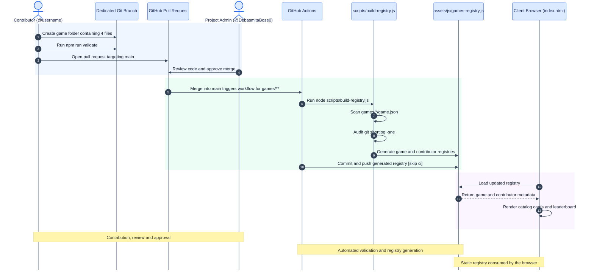
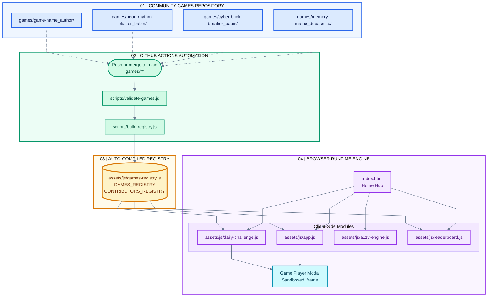
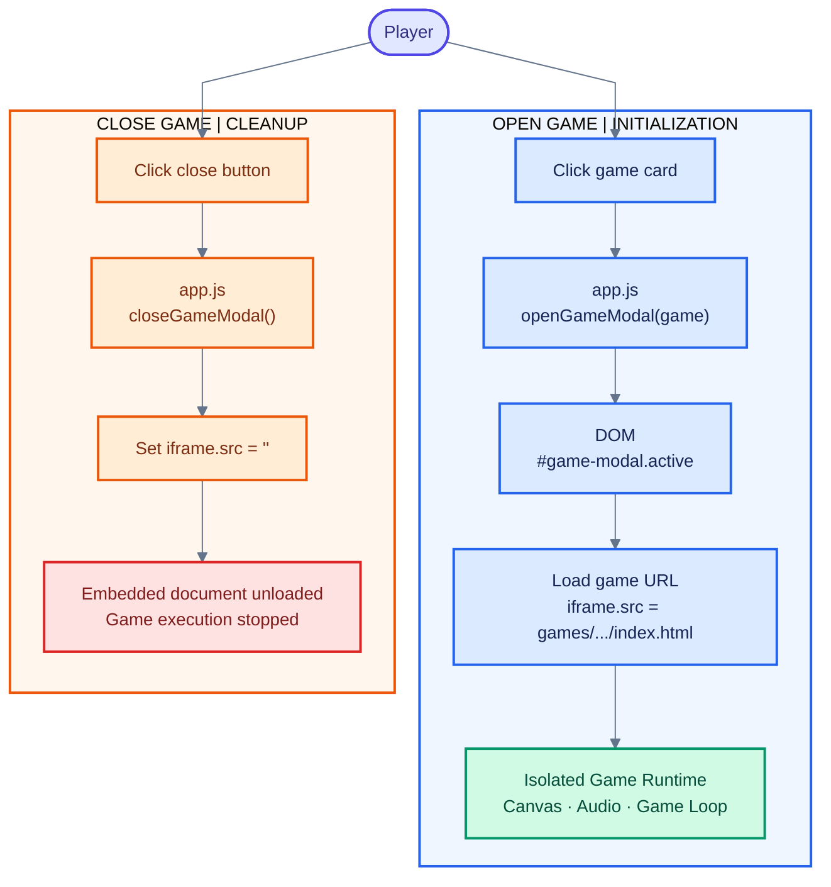

# ArcadeVerse — System Architecture & Workflow Specification

> **Nexus Spring of Code – Winter Edition 2026**  
> **Project Admin & Lead Architect:** Debasmita Bose ([@DebasmitaBose0](https://github.com/DebasmitaBose0))  
> **Core Architecture:** 100% Pure Native Web Standards (Vanilla HTML5 + CSS3 + Modern JavaScript). Zero Bundlers, Zero Frameworks, Zero Backend Services.

---

## 1. Architectural Philosophy & Guiding Principles

ArcadeVerse is an open-source web arcade platform engineered specifically for **high-concurrency open-source collaboration** during the 45-day **Nexus Spring of Code – Winter Edition 2026**.

To allow dozens of contributors to submit mini-games simultaneously without stepping on each other's code, ArcadeVerse enforces three architectural pillars:

1. **Zero-Bundler Simplicity:** No Node build steps, Webpack, Vite, or TypeScript compilation required to run the client. The application runs immediately in any browser by double-clicking `index.html`.
2. **Strict Folder Isolation (`games/<game-name_author>/`):** Every game is encapsulated within its own sandboxed subfolder. Contributors never touch shared platform code.
3. **Automated Continuous Integration Compilation:** Game registration, metadata indexing, and contributor commit calculations are compiled automatically via GitHub Actions upon pull request merge into `main`.

---

## 2. The 4-File Game Specification

Every playable game inside `games/<game-name_author>/` must strictly and exclusively contain four files:

```text
games/<game-name_author>/
├── index.html       # Game viewport markup & UI controls (SVG/Lucide icons only, NO emojis)
├── style.css        # Scoped styling, layout constraints, CRT/retro effects
├── game.js          # Pure client-side gameplay loop, state machine, audio & input handlers
└── game.json        # Standardized metadata declaration ingested by CI pipeline
```

### Standardized `game.json` Contract

```json
{
  "id": "cyber-brick-breaker",
  "title": "Cyber Brick Breaker",
  "category": "Arcade",
  "lucideIcon": "brick-wall",
  "description": "Deflect neon energy spheres through multi-layered cyber bricks with power-up capsules.",
  "author": "Babin Bid",
  "github": "Babin123456",
  "role": "Arcade Developer",
  "tags": ["Arcade", "Physics", "Retro"],
  "stars": 28,
  "featured": true,
  "difficulty": "Medium",
  "releaseDate": "2026-10-28"
}
```

---

## 3. End-to-End Automated CI/CD Compilation Pipeline

When a contributor pushes a game folder into `games/` and their Pull Request is merged into `main`, GitHub Actions automatically processes and indexes the new game without manual administrative overhead.

### Workflow Sequence Diagram



---

## 4. Platform Topology & Runtime Data Flow

ArcadeVerse employs a decentralized data flow where static declarations are compiled at build-time and hydrated dynamically in the browser DOM.

### Architecture Topology Flowchart



---

## 5. Client-Side Runtime Execution & Modal Isolation

Games execute inside a sandboxed `<iframe>` within the main application. This ensures:

1. **CSS Collision Prevention:** Game stylesheets cannot bleed into the host application or navigation bar.
2. **JavaScript Scope Isolation:** Global variables declared in games do not pollute the parent window.
3. **Clean Teardown:** Closing the player modal terminates game loops and releases audio contexts by clearing `iframe.src = ""`.



---

## 6. Dual Point Systems & Scoring Architecture

ArcadeVerse maintains two independent scoring tiers:

### 1. Official Nexus Spring of Code (NSoC '26) Program Points

Assigned manually by the Project Admin on the evaluation sheet upon merging:

- `level1` (**3 points**): Documentation, typo corrections, small patches.
- `level2` (**5 points**): UI layout enhancements, responsive design, components.
- `level3` (**10 points**): Verified playable games in `games/`, canvas physics, core architecture.

### 2. In-App Arcade XP Formula (Live Hall of Fame)

Dynamically synthesized in real time on [leaderboard.html](leaderboard.html):

$$
\mathbf{Arcade\ Score} = (\text{Games} \times 100) + (\text{Mechanics} \times 25) + (\text{Features} \times 50) + (\text{Fixes} \times 25) + (\mathbf{Commits} \times \mathbf{5})
$$

---

## 7. Universal Accessibility (WCAG 2.1 AAA) Engine

The **Accessibility Hub** (`assets/js/a11y-engine.js` & `assets/css/a11y-engine.css`) introduces sensory customization directly onto `document.documentElement`:

| Mode | Target Class | Visual Effect |
| :--- | :--- | :--- |
| **Reduced Motion** | `.a11y-reduced-motion` | Eliminates glow orbs, ambient grids, pulses, and forced instant transitions |
| **High Contrast** | `.a11y-high-contrast` | 7:1+ contrast ratio, bold 2px borders, pure solid black/white canvas |
| **Large Typography** | `.a11y-large-text` | 118% base font-size scaling across hero, catalog cards, and controls |
| **Focus Rings** | `.a11y-focus-highlight` | High-visibility 3px blue outline with offset for keyboard navigation |

All preferences are stored in `localStorage` under `arcadeverse_a11y_prefs` and dynamically respond to light and dark theme toggles.

---

## 8. Contributor Quality Gate CLI

Before creating a Pull Request, contributors can validate their game directory locally using the pre-flight validator:

```bash
npm test
# or
npm run validate
# or
node scripts/validate-games.js
```

The script audits:

- Exact directory naming convention: `games/<game-name_your-name>/`
- Presence of all 4 required files (`index.html`, `style.css`, `game.js`, `game.json`)
- Strict JSON schema validity and required attributes
- Prohibition of raw Unicode emojis in markup in favor of SVG/Lucide icons
- Proper relative asset paths

---

## 9. Key Documentation Links

- [Contribution Guidelines](CONTRIBUTING.md)
- [Code of Conduct](CODE_OF_CONDUCT.md)
- [Security Policy](SECURITY.md)
- [Open Source License (MIT)](LICENSE)
